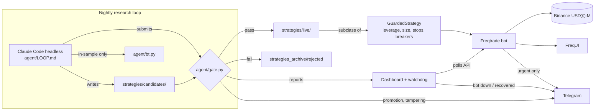

# ADR-0001: Guarded autonomous crypto futures trading

- Status: accepted
- Date: 2026-10-29

## Context

Goal: an AI system that trades crypto by itself and improves itself, on a $400 budget
for 3 months (Claude Pro ~$60, about $340 trading capital). KPI: profit >= 2x operating
cost over the whole period, not every month. Constraints from the operator: Binance
USDⓈ-M futures only, leverage at most 10x, push in active markets, accept small losses in
dull ones, never force trades to hit the KPI. Runs on a local Mac first, later on an
existing VM.

Evidence that shaped the design:

- LLMs placing orders directly did poorly in live tests (Alpha Arena, LiveTradeBench):
  good at research, weak at timing and sizing.
- Backtests that look great often fail live because of lookahead bias or overfitting.
- An autonomous agent that can edit its own risk rules can remove them.

## Decision

Split the system so the LLM never decides risk and never places orders.

1. **Execution**: Freqtrade 2026.9 in Docker, futures, isolated margin, market orders,
   stop-loss placed on the exchange (`stoploss_on_exchange`, mark price) so positions stay
   protected if the host or network goes down.
2. **Guardrails** (`user_data/strategies/guarded_strategy.py`, operator-owned):
   - The stop always costs 20% of the stake; leverage = 0.20 / stop distance, capped at 10x,
     so leverage only changes margin, not money at risk.
   - Stake = equity x 1% x regime multiplier / 0.20; total open notional <= 10x equity.
   - Drawdown breakers: 5% / day, 10% / week, 20% / month (equity mode).
   - No new entries below 200/340 of the starting balance.
   - No position adjustment (no averaging down / martingale).
   - `__init_subclass__` rejects subclasses that override any of this.
3. **Research agent**: Claude Code headless, permissions limited by
   `agent/loop.settings.json` (`--permission-mode dontAsk`, user settings and MCP not
   loaded). It may only write `strategies/candidates/` and `agent/journal/`, run
   `bt.py`, `gate.py`, `perf_snapshot.py`. It cannot read secrets or gate results.
   It runs in its own `research` container (Freqtrade image + Claude Code CLI, started
   daily by `agent/scheduler.sh`) that receives no exchange keys, has `.env` masked, and
   has no Docker socket, so a misbehaving agent cannot reach the bot's credentials or the
   host.
4. **Gate** (deterministic Python, no LLM): integrity hash of protected files, AST checks
   (one `GuardedStrategy` subclass, allow-listed imports, no escape hatches), full test
   suite, Freqtrade lookahead-analysis, in-sample and held-out out-of-sample backtests
   against fixed criteria, and the candidate must beat the live strategy out of sample.
   The latest 120 days are held out: `bt.py` refuses them and the agent only sees which
   out-of-sample criteria failed, not the numbers.
5. **Observability**: a read-only activity dashboard on `127.0.0.1:8081` (`dashboard/app.py`,
   FastAPI from the Freqtrade image, FreqUI credentials) shows the bot, the research
   journal, gate decisions and strategy history; FreqUI on `127.0.0.1:8080` stays the admin
   UI. Telegram is reserved for urgent alerts so they are not drowned out: Freqtrade
   warnings, exceptions, liquidations, emergency exits and global drawdown breakers; a
   watchdog in the dashboard container that alerts when the bot API stops answering or
   leaves RUNNING for 3 checks (Freqtrade cannot report its own death); promotions,
   tampered guardrails and failed research loops. Freqtrade's Telegram commands
   (`/status`, `/pause`, `/forceexit`, `/stop`) remain available.

## Consequences

- Risk rules change only through a deliberate operator edit plus `make lock`.
- Promotion is automatic. The first live version is a simple trend breakout with a
  regime filter; it is a starting point, not a proven edge.
- Repeated gate submissions slowly leak information about the held-out window; the
  window rolls forward daily, which limits but does not remove this.
- In-sample test of the protections (2025-08-15 to 2026-07-01) showed StoplossGuard
  turned +38% into -16% for a ~30% win-rate trend strategy, so it is not used; the
  drawdown breakers stay. Base risk was lowered from 1.5% to 1% after the backtest
  drawdown reached 35-45%.
- The watchdog runs on the same Docker host as the bot, so it cannot report the host or
  Docker itself going down; exchange-side stop-losses cover open positions in that case.
- Freqtrade does not support custom Telegram commands; controlling the research loop
  from Telegram needs a second bot (not built).
- Deployment is `git clone`, fill `.env`, `docker compose up`. Secrets live only in `.env`
  and reach the bot as `FREQTRADE__*` variables; Telegram and REST API settings are in
  `config.rpc.json`, which only the running bot loads, so backtests need no secrets.
- The research loop authenticates with a `claude setup-token` OAuth token (one-year
  lifetime) in `.env`; when it is missing or expired the loop is skipped with an alert.
- The gate promotes strategies inside the deployment checkout, which therefore diverges
  from git until those changes are committed back.
