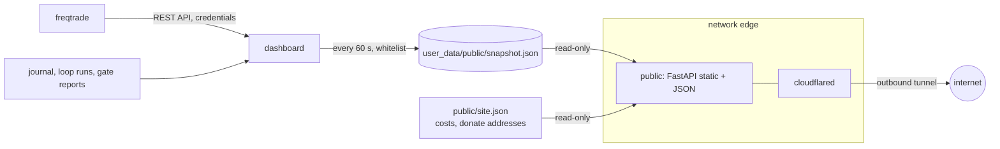

# ADR-0002: Public status page

- Status: accepted
- Date: 2026-10-31

## Context

The operator wants a public, playful page that shows what the bot is doing, to attract an
audience and ask for donations that cover operating costs. Until now every UI (FreqUI,
the agent dashboard) was private behind an SSH tunnel, on a VM that holds the Binance key.

Risks of going public:

- A web service reachable from the internet next to exchange keys.
- Leaking the gate's out-of-sample results. The research agent has network access, so
  anything on a public page is something the agent can read. If held-out numbers were
  published, the holdout would stop being a holdout.
- Leaking operational details (hostnames, error messages, logs).
- Asking for money next to trading results can read as an investment offer.

## Decision

A separate `public` container serves a static page and a sanitized JSON snapshot.

- **Whitelist, not blacklist.** `dashboard/public_snapshot.py` copies named fields only.
  Gate reports contribute in-sample metrics and failed check names; `out_of_sample_private`,
  test logs and error messages never leave. A bot outage is published as `online: false`
  without the exception. Tests assert that the secrets, the out-of-sample values and the
  logs do not appear in the snapshot.
- **No secrets, no route to the bot.** The `public` and `cloudflared` services have no
  secret environment variables and sit on their own compose network `edge`, so they
  cannot reach the Freqtrade API. `public` mounts only `public/` and the snapshot directory,
  both read-only.
- **No inbound ports.** A Cloudflare quick tunnel publishes the page over an outbound
  connection (random `*.trycloudflare.com` URL for now; a named tunnel on the operator's
  domain later). The page is also on `127.0.0.1:8082` for local checks.
- **Locked-down page.** Strict CSP (`script-src 'self'`, no third-party scripts or
  analytics), all data rendered with `textContent`, QR images only from `public/static/qr/`.
  A third-party script on a donation page could swap the addresses. The only third party is
  Google Fonts (CSS and font files, for the pixel fonts Tiny5 and VT323, both with Vietnamese
  glyphs); it sees visitors' IPs. Self-host the fonts if that becomes a concern.
- **Fun without cost.** Retro game theme: a pixel-art mascot whose mood is derived in the
  snapshot from bot state (down, researching, winning, nervous, happy, sad, idle), bilingual
  (EN/VI) dialog templates, no LLM calls. Game stats map to real numbers: hearts follow the
  current drawdown (empty at 20%, where the monthly breaker pauses the bot), XP is profit
  against the cost goal, energy is the days left in the season, and the level counts
  finished research nights. Achievements unlock from the same snapshot.
- **Donations are gifts.** The page states paper trading clearly, says it is not financial
  advice or a signal service, and that donations bring no returns or profit share.
  Donation addresses and costs live in the gitignored `public/site.json`.
- The research agent cannot edit `public/**` or `user_data/public/**`; `public/app.py` and
  `dashboard/public_snapshot.py` are guardrail-locked.

## Consequences

- Trading results are public in real time, including open positions. Acceptable at this
  capital size; revisit if capital grows enough for front-running to matter.
- The quick tunnel URL changes when `cloudflared` restarts and has no uptime guarantee.
  Good enough to start; switch to a named tunnel (`TUNNEL_TOKEN`) once a domain exists.
- The research agent can read everything on the page. That is by design: the page holds
  nothing the agent cannot already see.
- `user_data/public/` must be writable by uid 1000 on the VM (covered by the existing
  `chown -R 1000:1000 user_data agent`).
