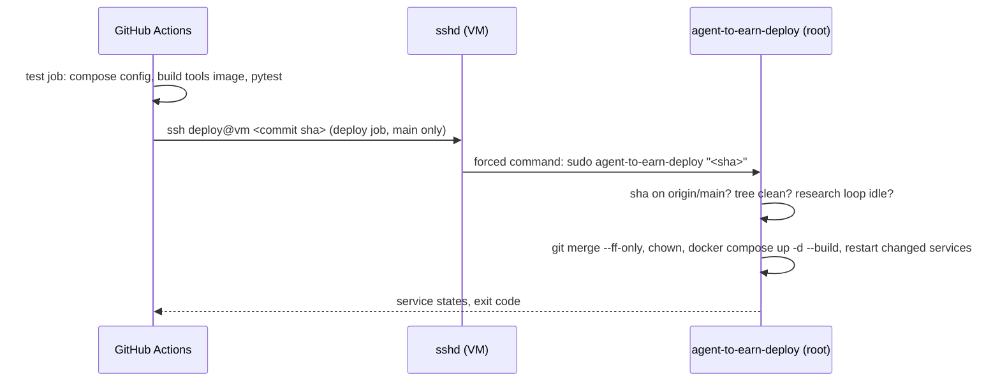

# ADR-0003: Continuous deployment from GitHub Actions

- Status: accepted
- Date: 2026-10-31

## Context

Deploys were manual: SSH to the VM as root, `git pull`, fix ownership, `docker compose up`.
The operator wants pushes to `main` to deploy automatically. The VM holds the Binance key,
and the repository is public, so the credential GitHub holds must be worth as little as
possible if it leaks.

## Decision

- **One-command key.** `scripts/setup_deploy_user.sh` (run once by the operator on the VM)
  creates a passwordless `deploy` user. Its only authorized key has
  `restrict,command="sudo -n /usr/local/bin/agent-to-earn-deploy \"$SSH_ORIGINAL_COMMAND\""`:
  no shell, no port forwarding, and whatever the client sends becomes the script's argument.
  Sudoers allows that one script and nothing else.
- **The script accepts only a commit of `origin/main`.** It validates a 40-hex sha, checks
  that it is an ancestor of `origin/main`, then fast-forwards. A leaked key can redeploy code
  that is already on `main`, nothing more.
- **Root-owned copy.** The script runs from `/usr/local/bin`, not from the repo: the repo is
  writable by the containers (uid 1000), so running a repo file as root would let a container
  escalate. Re-run the setup script after changing `scripts/vm_deploy.sh`.
- **Key generated on the VM**, printed once for the GitHub secret, then deleted. Host keys
  are pinned through `VM_KNOWN_HOSTS` (`StrictHostKeyChecking=yes`).
- **Safe refusals.** No deploy while the research loop holds its lock (recreating the
  container would kill it), and no deploy over local changes to tracked files (gate
  promotions); the job fails with the reason instead.
- **Gating.** Deploy runs only for pushes to `main` after the test job passes, one at a
  time (`concurrency`), in the `production` environment. Pull requests, including from
  forks, run tests without secrets. Without the secrets the deploy step is skipped.
- Only first-party code runs in the workflow: `actions/checkout` pinned by commit sha, the
  rest is shell and Docker.

## Consequences

- A promoted strategy on the VM blocks deploys until the operator commits it from the VM
  and pushes (or discards it). This is deliberate: the VM checkout is the source of truth
  for the live strategy (README, "Daily operation").
- A deploy that lands during the research window (01:00 UTC by default) fails and has to
  be re-run from the Actions tab.
- `docker compose up -d` recreates only services whose configuration changed, so the script
  also restarts services whose mounted code changed (dashboard and agent modules, the public
  app, bot config and live strategy, the scheduler). Static files of the public page and the
  research loop scripts are read fresh and need no restart. Keep that mapping in
  `scripts/vm_deploy.sh` in sync when services start loading new files.
- The VM still allows root and password SSH logins. That is outside this change, but
  disabling both (`PermitRootLogin prohibit-password`, `PasswordAuthentication no`) is
  recommended now that deploys no longer need root over SSH.
