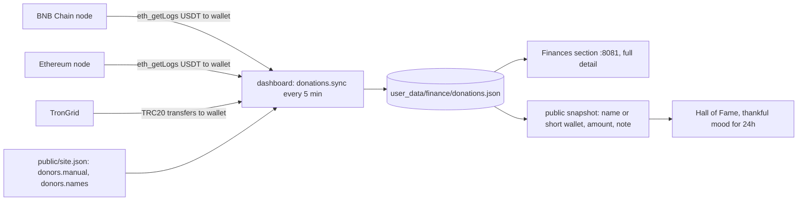

# ADR-0004: Donation tracking and the finances ledger

- Status: accepted
- Date: 2026-10-31

## Context

The public page lists USDT wallets (BEP20, ERC20, TRC20) and a Momo QR. The operator wants
donors thanked on the page and one private view of the season's money: running costs, bot
P&L, donations and the KPI (bot profit ≥ 2× running costs).

Facts checked on 2026-10-31:

- The Etherscan API v2 free tier answers "Free API access is not supported for this chain"
  for BNB Chain (chain 56); Ethereum is still free.
- `bsc-rpc.publicnode.com` and `ethereum-rpc.publicnode.com` serve `eth_getLogs` without a
  key, but only over recent history (10 000 blocks back worked, 30 000 back on Ethereum and
  3 000 000 back on BNB Chain needed a token). Logs carry `blockTimestamp`.
- TronGrid lists TRC20 transfers per account without a key.
- Personal Momo accounts have no API or webhook. Transfers between Binance users to a
  Binance deposit address are settled inside Binance and never reach a chain.

## Decision

- **No API keys.** Public nodes and TronGrid only, so there is no new secret to store or leak.
- **Persistent cursor.** The last scanned block per wallet and every transfer found are kept
  in a private state file, written atomically. A restart or an outage only delays updates.
  New wallets start about a day back. If a node no longer has the history between the cursor
  and now, the gap is skipped and recorded, and the Finances section shows it so the operator
  can check the explorer and add anything missed by hand.
- **Spam filter.** Only the official USDT contracts count, and transfers under 1 USDT are
  ignored (address poisoning sends dust from look-alike wallets).
- **Manual entries** in `site.json` cover Momo and internal Binance transfers. VND amounts
  are converted with `vnd_per_usd`.
- **Privacy.** The public snapshot carries the operator-given name or a shortened wallet,
  never the full wallet or the transaction hash. The private dashboard shows both.
- **Donations are not profit.** The KPI and the public XP bar use bot P&L only; donations
  are shown next to them ("covered X% of running costs").
- `dashboard/donations.py` and `dashboard/finance.py` are protected by the gate, and the
  research agent may not edit `user_data/finance/`.

## Consequences

- A donor's name appears only after the operator maps their wallet or tx in `donors.names`.
- Public nodes can rate-limit or go away; replacing one is a one-line change in `EVM`.
- Gaps longer than the node's history are skipped, not recovered. On Ethereum that history
  was between 10 000 and 30 000 blocks (about 1.5 to 4 days of dashboard downtime).
- The season arithmetic exists twice, in `dashboard/finance.py` and in the public page's
  `economy()` (JavaScript); keep them in sync.
